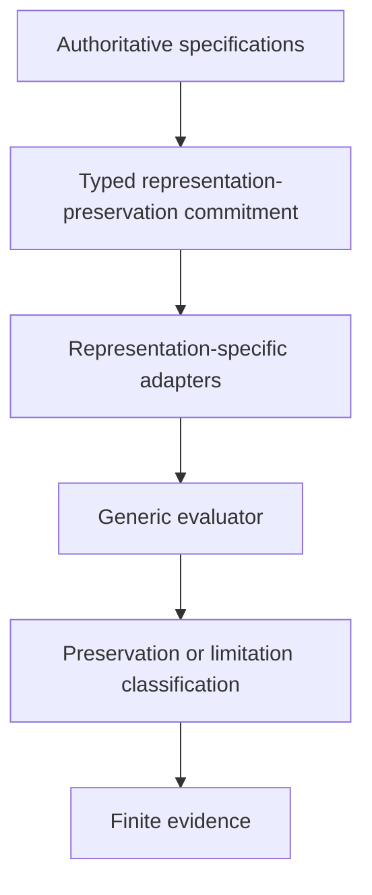
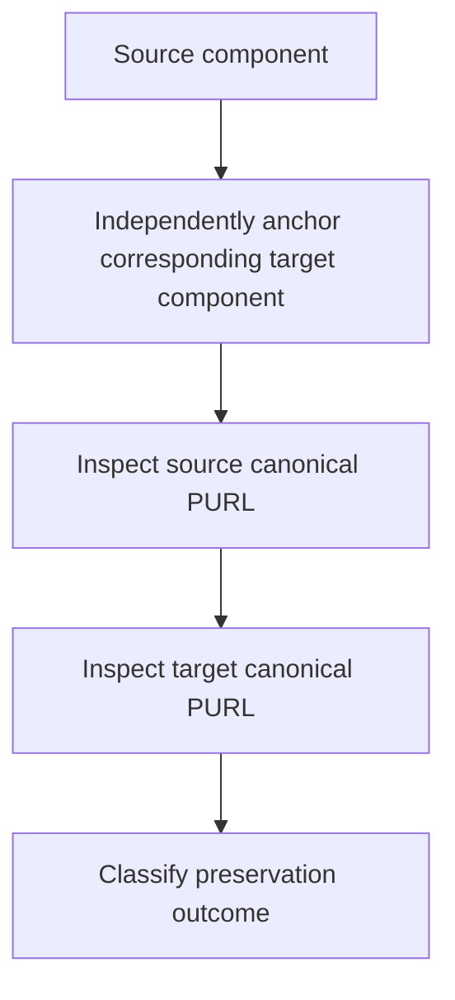

# SE Pilot Overview: Identity Preservation in Software Supply Chains

> A feasibility pilot for source-grounded identity-preservation conformance
> across software supply-chain representations.

## Purpose

This project tests whether security-relevant identity commitments can be
defined from authoritative sources and evaluated systematically across
software supply-chain transformations.

The initial test is intentionally narrow:

- commitment kind: `representation_preservation`;
- identifier: Package URL (PURL);
- representations: SPDX and CycloneDX SBOMs;
- question: whether identity information survives a representation
  transformation in its canonical target location.

The project does not begin by searching for implementation defects.

It defines the preservation obligation first, establishes the evaluation
procedure, freezes the commitment and evaluator under researcher control, and
then performs engineering validation before any separately frozen
generalization execution.

## Research Motivation

Software supply-chain tools routinely transform records describing the same
components between different representations.

A transformation can remain syntactically valid while changing, relocating, or
losing identity-bearing information used by downstream security tooling.

For example, two formats may both support PURL while representing it in
different structural locations.

The relevant conformance question is:

> Did the transformation preserve the source-grounded identity semantics
> required on the target side?

## Initial Method

## Initial Method

The evaluator is separated from format-specific parsing.

It must not contain special cases for particular packages, historical bugs,
converters, or artifacts.

## Initial Commitment

The first commitment concerns PURL preservation across SPDX and CycloneDX.

The evaluator distinguishes preservation violations from explicit refusal or
limitation outcomes.

A transformation must not be classified as violating a preservation
commitment when the target representation cannot express the relevant
semantic construct or when the corresponding target component cannot be
established reliably.

See the [Run Protocol](./run.md) for the verdict vocabulary and adjudication
rules.

## Evidence Roles

The pilot distinguishes three evidence roles.

### Design Evidence

Specifications and documented mappings used to define the commitment,
representation semantics, and adjudication rules.

### Engineering Validation Evidence

Synthetic fixtures, previously known examples, controlled regression pairs,
and exploratory release sweeps used to verify evaluator behavior and
repeatability.

Known examples and behaviors observed during engineering validation are not
treated as held-out evidence when they were available before the
generalization corpus is frozen.

### Generalization Evidence

Previously unexamined transformation outputs evaluated only after the
commitment, evaluator, and adjudication procedure have been frozen and the
generalization corpus and execution conditions have been separately fixed.

The generalization stage tests whether the frozen preservation rule identifies
useful preservation failures beyond the examples known during development.

## Role in Structural Explainability

This pilot is part of the Structural Explainability research program.

It is informed by the SE-210 Operational Identity framework but does not assume
that every software supply-chain semantic rule
is an SE-210 operational-identity relation.

This initial pilot tests the lower-level preservation-conformance primitive
first.
It is not an SE-210 partition audit.

If observed transformations later produce non-trivial competing identity
groupings, the study can then evaluate whether SE-210 provides additional
structural analysis beyond the preservation checker itself.

Related work:

- [SE-210 Operational Identity paper](https://arxiv.org/abs/2607.20729)
- [Executable verification of the SE-210 finite mathematical core](https://github.com/structural-explainability/se-verification-operational-identity)

## Broader Research Direction

Software supply chains are the first proving ground for the
identity-preservation method.

The broader research question is whether the same source-grounded method can
support other domains in which identity must survive or change predictably
across representation, custody, provenance, aggregation, transformation, or
interpretation.

## Current Status

### Commitment and Evaluator

The initial commitment, interpretation rules, evaluator, and adjudication
protocol are frozen under Freeze 01.

### Engineering Validation

Engineering validation has been completed against real historical artifacts
from CycloneDX/cyclonedx-cli issue #424.

The known-bad execution using `cyclonedx-cli` `0.31.0` with
`CycloneDX.Spdx.Interop` `11.0.0` produces `VIOLATED_RELOCATED`.

The first identified CLI release using a dependent library that includes the
relevant PURL fix, `cyclonedx-cli` `0.32.0` with
`CycloneDX.Spdx.Interop` `12.1.1`, produces `PRESERVED`.

An automated release sweep additionally evaluates the same preserved source,
transformation direction, frozen commitment, and evaluator across surrounding
released CLI versions.

These results remain engineering-validation evidence because the relevant
release history and behavior were examined before the held-out experiment.

### Generalization Preparation

The held-out corpus, preserved source artifacts, transformation matrix,
converter artifacts, runtime dependencies, and target validator have been
constructed under the pre-outcome preparation procedure.

The Windows x64 engineering smoke test has completed and passed verification.
It exercised all three declared converters using previously examined validation
sources, with a maximum observed subprocess duration of approximately
3.92 seconds against the declared 300-second timeout.

The executor retains separate transformation, target-validation, and
preservation-evaluation evidence.

Freeze 02 integrity verification covers the complete repository-local Java
runtime, including its libraries, modules, and release metadata.

Baseline predictions and hypotheses for a later IdentityOps comparison have
been recorded before held-out execution.

### Software Release and Archive

The smoke-tested software state was released as
[v0.4.0](https://github.com/structural-explainability/se-pilot-identity-preservation-supply-chain-software/releases/tag/v0.4.0)
and archived with version-specific DOI
[10.5281/zenodo.23979461](https://doi.org/10.5281/zenodo.23979461).

### Research Freeze and Held-Out Execution

The software release and research freeze are separate events.

Freeze 02 has not yet been established, and no held-out generalization
transformation has been executed or examined.

No held-out generalization evidence is currently claimed.

## Procedures and Commands

- [Generalization Execution Workflow](https://github.com/structural-explainability/se-pilot-identity-preservation-supply-chain-software/blob/main/generalization/README.md#execution-workflow)
  provides the ordered preparation, freeze creation, formal execution,
  and post-run evidence-preservation commands.
- [Executor and Integrity Verification](https://github.com/structural-explainability/se-pilot-identity-preservation-supply-chain-software/blob/main/docs/en/executor.md)
  documents evidence layout, environment controls, timeouts, interruption
  handling, and apparatus verification.
- [Run Protocol](./run.md)
  defines the scientific freeze, evaluation, and adjudication rules.
- [Test Guide](./test.md)
  describes synthetic fixtures and engineering-validation checks.

## Study Outputs and Artifacts

### Commitment Definitions and Sources

- [Commitment Schema](https://github.com/structural-explainability/se-pilot-identity-preservation-supply-chain-software/blob/main/contracts/schema.md)
  defines the typed commitment model.
- [Commitments](https://github.com/structural-explainability/se-pilot-identity-preservation-supply-chain-software/blob/main/contracts/commitments.toml)
  contains the encoded preservation obligations.
- [Authoritative Sources](https://github.com/structural-explainability/se-pilot-identity-preservation-supply-chain-software/blob/main/contracts/sources.toml)
  records the specifications and provenance supporting those obligations.

### Freeze and Prediction Records

- [Freeze 01 Record](https://github.com/structural-explainability/se-pilot-identity-preservation-supply-chain-software/blob/main/contracts/FREEZE_01_COMMITMENT_EVALUATOR.md)
  records the researcher-controlled freeze of the initial commitment,
  interpretation rules, evaluator, and adjudication protocol.
- [Freeze 02 Record](https://github.com/structural-explainability/se-pilot-identity-preservation-supply-chain-software/blob/main/contracts/FREEZE_02_GENERALIZATION.md)
  declares the generalization conditions and records the artifact hashes
  when that freeze is established.
- [Pre-execution Predictions](https://github.com/structural-explainability/se-pilot-identity-preservation-supply-chain-software/blob/main/generalization/PREDICTIONS.md)
  records baseline predictions and hypotheses for the later IdentityOps
  comparison.

### Engineering Validation Evidence

- [Historical Validation Cases](https://github.com/structural-explainability/se-pilot-identity-preservation-supply-chain-software/blob/main/validation/README.md)
  records the known historical cases and their adjudicated results.
- [Forward Release Sweep](https://github.com/structural-explainability/se-pilot-identity-preservation-supply-chain-software/blob/main/validation/cyclonedx-cli-424-release-sweep/README.md)
  documents engineering validation across released `cyclonedx-cli` versions.
- [Reverse Release Sweep](https://github.com/structural-explainability/se-pilot-identity-preservation-supply-chain-software/blob/main/validation/cyclonedx-cli-reverse-sweep/README.md)
  documents CycloneDX-to-SPDX engineering validation.
- [Executor Smoke Evidence](https://github.com/structural-explainability/se-pilot-identity-preservation-supply-chain-software/tree/main/validation/executor-smoke)
  retains the known-source smoke plan, generated targets, validation results,
  evaluator outputs, logs, and execution records.

## Repository Guidance

For repository setup, development commands, citation, licensing, and repository
structure, see the
[project README](https://github.com/structural-explainability/se-pilot-identity-preservation-supply-chain-software/blob/main/README.md).
